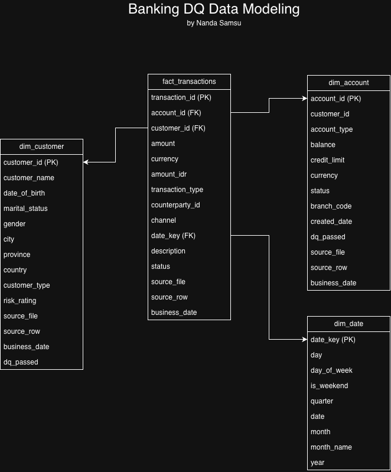
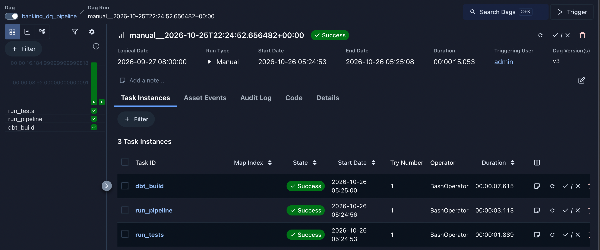

# Banking DQ ETL


A data quality pipeline for banking data, built with Python, with two versions: a local one on PostgreSQL and a cloud one on AWS (S3, Glue, Athena). It loads raw customer, account and transaction files, checks them against 15 data quality rules, produces a scorecard showing the pass rate per table and the number of failures per rule, and builds a tested star schema data mart from the records that passed, using dbt. The whole run is orchestrated by an Airflow DAG.

I work on SQL-based ETL and data quality in banking. I built this project to rebuild that kind of process in Python with modern data engineering practices: version control, lineage, rerunnable loads and reproducible setup.

All data is synthetic. Nothing comes from a real bank.

## Results

DQ scorecard for business date '2026-09-27':

| Table         | Total rows | Failed rows | Passed rows | Pass rate |
| ---           | ---:       | ---:        | ---:        | ---:      |
| accounts      | 1,500      | 55          | 1,445       | 96.33%    |
| customers     | 1,020      | 62          | 958         | 93.92%    |
| transactions  | 20,160     | 1,688       | 18,472      | 91.63%    |

Failures per rule:

| Rule | Dimension | Description | Failed rows |
| --- | --- | --- | ---: |
| T04 | Consistency | posting currency differs from account currency | 328 |
| T07 | Uniqueness | transaction_id appears more than once | 320 |
| T02 | Accuracy | amount is empty, zero or negative | 299 |
| T06 | Validity | transaction_timestamp is not a valid timestamp | 295 |
| T01 | Integrity | account_id not found in accounts | 241 |
| T05 | Completeness | TRANSFER has no counterparty_account_id | 148 |
| T03 | Timeliness | transaction_timestamp is after the business date | 100 |
| C05 | Validity | email format is invalid | 27 |
| A01 | Integrity | customer_id not found in customers | 22 |
| C02 | Uniqueness | customer_id appears more than once | 20 |
| A03 | Validity | created_date is not a valid date | 18 |
| C03 | Validity | date_of_birth is not a valid date or is in the future | 15 |
| A02 | Completeness | CREDIT account has no credit_limit | 15 |
| C01 | Completeness | customer_id is empty | 0 |
| C04 | Validity | country is not ID, SG or MY | 0 |

C04 has 0 failures because standardization maps every country variant in the raw file (`INDONESIA`, `INA`, `SGP`, ...) to an ISO code before validation runs.

1,848 exceptions in total. The local version and the AWS version run the same code and give the same numbers.

## How it works

```
raw CSV files
   │  extract.py      read as text, add source_file, source_row, business_date
   ▼
staging.*            exact copy of the raw files (evidence)
   │  standardize.py  trim, upper-case, map codes (RP → IDR, AKTIF → ACTIVE, ...)
   ▼
dq_rules.py          15 rules across 7 DQ dimensions
   │
   ▼
dq.exceptions        one row per failed record per rule, with lineage
   │
   ▼
dq.scorecard_table   pass rate per table
dq.scorecard_rule    failures per rule (every rule listed, including 0)
   │
   │  dbt (banking_dbt/)
   ▼
analytics.clean_*    records that passed every rule, with proper data types
   ▼
analytics star schema: fact_transactions + dim_customer, dim_account, dim_date
```

The Python part runs with `python -m banking_dq.pipeline --business_date 20260927`, the dbt part with `dbt build`. Airflow runs both in order (see below).

## Data mart (dbt)

Python decides which records are bad. dbt turns the good records into a clean, tested data mart for reporting and analytics.

| Layer | Models | What it does |
| --- | --- | --- |
| Sources | `staging.*`, `standardized.*`, `dq.exceptions` | Tables loaded by the Python pipeline |
| Clean | `clean_customers`, `clean_accounts`, `clean_transactions`, `clean_fx_rates` | Standardized records minus every record that failed a DQ rule, with real types (dates, numeric amounts) |
| Mart | `fact_transactions`, `dim_customer`, `dim_account`, `dim_date` | Star schema, one row per transaction in the fact table |




48 dbt tests run on every build: `not_null` and `unique` on every key, `relationships` from the fact to each dimension, and `not_null` on `amount_idr`.

Example: total transaction value in IDR per country per day is now one simple query.

```sql
SELECT c.country, d.date, SUM(f.amount_idr) AS total_idr
FROM analytics.fact_transactions f
JOIN analytics.dim_customer c ON c.customer_id = f.customer_id
JOIN analytics.dim_date d     ON d.date_key   = f.date_key
GROUP BY c.country, d.date;
```

## Orchestration (Airflow)

One Airflow 3 DAG (`dags/banking_dq_dag.py`) runs the whole local pipeline in order:

```
run_tests  →  run_pipeline  →  dbt_build
 (pytest)     (Python DQ)      (dbt clean layer + star schema, 48 tests)
```

- **Tests are a gate.** If a pytest test fails, the pipeline and dbt never run, so broken rule logic never touches the database.
- **The business date comes from Airflow.** `run_pipeline` gets `--business_date {{ ds_nodash }}`, the logical date of the run. Any day can be re-run or backfilled by triggering the DAG for that date, with no code change.
- **A missing source partition stops the run.** If there are no raw files for the date, `run_pipeline` fails and `dbt_build` is marked `upstream_failed`, so the mart is never rebuilt on incomplete data.



## AWS version

The same DQ code also runs on AWS. Only the input and output change, the rules are shared.

| Local version | AWS version |
| --- | --- |
| `data/raw/*.csv` | S3 raw zone, partitioned: `raw/<table>/business_date=20260927/` |
| PostgreSQL staging | Glue Data Catalog tables over S3 (`banking_raw`), queried with Athena |
| `python -m banking_dq.pipeline` on my laptop | `aws_job.py` as a Glue Python shell job |
| `dq.exceptions` table | Parquet files in S3 curated zone (`banking_curated.dq_exceptions`) |
| scorecard views in PostgreSQL | scorecard views in Athena |

```
s3://.../raw/<table>/business_date=.../*.csv
   │  Glue Python shell job (aws_job.py)
   │  read_raw → run_dq (same code as local)
   ▼
s3://.../curated/dq_exception/business_date=.../exceptions.parquet
s3://.../curated/rule_catalog/rule_catalog.parquet
   │  Athena
   ▼
banking_curated.scorecard_table / scorecard_rule
```

The `banking_dq` package is built as a wheel (`pyproject.toml`) and installed by the Glue job, so the code that runs in AWS is the same code that is tested locally.

## Design decisions

- **Staging is loaded before standardizing.** Staging stays an exact copy of the source files, so it can serve as evidence of what the source system actually sent.
- **Every exception keeps its lineage.** `source_file` and `source_row` point back to the exact line in the raw CSV, so a failed record can be traced and reported to the data owner.
- **Reruns are idempotent.** Before loading exceptions, the pipeline deletes any rows for the same `business_date`. Running the same day twice gives the same result, with no duplicates.
- **Scorecard views are rebuilt every run.** Staging tables are dropped with `CASCADE` and the views are recreated from `sql/scorecard.sql` at the end of the pipeline.
- **DQ checks run after standardization.** This avoids false alarms from formatting differences (for example `' id '` vs `ID`).
- **Rules don't cascade into each other.** For example T04 only compares currencies when the account exists, so an orphan transaction is counted once under T01 and not again under T04.
- **Rule logic is tested.** pytest tests feed each rule a small hand-made DataFrame where the correct answer is known in advance, including edge cases: empty IDs are not counted as duplicates, only CREDIT accounts need a credit limit, and an orphan transaction is flagged by T01 but not double-counted by T04.
- **One shared DQ function for both versions.** `run_dq()` holds the standardize and DQ steps. `pipeline.py` (PostgreSQL) and `aws_job.py` (AWS) both call it, so the two versions cannot drift apart. It works on copies of the input DataFrames, so the raw data is never changed by accident.
- **Raw is read-only for the Glue job.** The IAM role of the job can read the whole bucket but can only write to `curated/`. The pipeline itself cannot change or delete the raw files, so they stay as evidence.
- **Raw tables are all string, curated is typed.** The raw Athena tables keep every column as text, exactly as received, so bad values stay visible. The curated layer is Parquet with real data types.
- **Parity testing found a real bug.** Running the same code locally and on Glue gave different C03 counts (15 vs 11). The older pandas version on Glue accepted dates like `28/03/2009` and `19501127` as valid. I fixed it by checking the `YYYY-MM-DD` format with an explicit regex before parsing, and added a regression test, so the rule no longer depends on the pandas version.
- **dbt tests found gaps in the DQ rules.** Casting the clean layer to real types and testing its keys exposed records that passed every Python rule: impossible timestamps (`2026-02-30`), impossible account dates and 151 duplicated transaction IDs. I fixed them in Python, where they get reported, by adding rules T06, A03 and T07, instead of hiding them in SQL.
- **A failed parent does not drop its children.** When an account fails DQ, its transactions stay in the fact table, because dropping real transactions would understate totals in reports. `dim_account` and `dim_customer` include every record with a `dq_passed` flag, and an `UNKNOWN` customer row catches accounts whose customer does not exist.
- **As-of exchange rates.** FX rates exist only for business days, so `amount_idr` uses the latest rate on or before the transaction date (a lateral join). A `not_null` test proves every transaction found a rate, weekends included.
- **Data minimisation.** The clean and mart layers leave out personal data analysts do not need, such as ID card numbers, email and phone numbers (UU PDP).
- **Airflow runs in its own virtual environment.** Airflow pins many library versions, so it lives in `.venv-airflow` and calls the project's own `.venv/bin/python` and `.venv/bin/dbt`. The pipeline and Airflow can be upgraded independently.
- **Assumption for T04:** `transactions.currency` is the posting currency, which must match the account currency.

## Project layout

```
banking_dq/
  extract.py        read raw CSVs and add lineage columns
  standardize.py    generic value standardization
  mappings.py       code mappings (currency, status, country, transaction type)
  dq_rules.py       the 15 DQ rules
  rule_catalog.py   rule ID, dimension and description
  load.py           load to PostgreSQL, run SQL files
  db.py             database connection from .env
  dq_run.py         run_dq(): standardize + DQ rules, shared by both versions
  pipeline.py       local version: runs everything end to end on PostgreSQL
  aws_job.py        AWS version: reads S3, runs run_dq, writes Parquet to S3
sql/scorecard.sql   scorecard views (PostgreSQL)
banking_dbt/        dbt project: sources, clean layer, star schema mart, tests
dags/               Airflow DAG: pytest -> pipeline -> dbt build
docs/               star schema diagram, dbt lineage graph, Airflow run
aws/athena/         Athena DDL: raw tables, curated tables, scorecard views
aws/glue/           command to create the Glue job
aws/iam/            IAM policies for the Glue job role
pyproject.toml      builds banking_dq as a wheel for Glue
scripts/profile_raw.py   read-only profiling of the raw files
data/raw/           synthetic source files for 2026-09-27
tests/              pytest tests for the DQ rules
```

## How to run

Requirements: Python 3.12, Docker.

```bash
# 1. Start PostgreSQL
docker run --name banking-postgres \
  -e POSTGRES_USER=etl_user -e POSTGRES_PASSWORD=changeme -e POSTGRES_DB=banking_dw \
  -p 5432:5432 -d postgres:16

# 2. Set up Python
python -m venv .venv
source .venv/bin/activate
pip install -r requirements.txt
cp .env.example .env              # edit DB_PASSWORD if you changed it

# 3. Run the pipeline for one business date
python -m banking_dq.pipeline --business_date 20260927

# 4. Run the tests
python -m pytest -v

# 5. Build and test the dbt data mart
set -a; source .env; set +a      # dbt reads the DB settings from environment variables
cd banking_dbt
dbt build
```

### Run with Airflow

Airflow needs its own environment (Python 3.10 to 3.14):

```bash
python3.12 -m venv .venv-airflow
source .venv-airflow/bin/activate
pip install "apache-airflow==3.3.2" \
  --constraint "https://raw.githubusercontent.com/apache/airflow/constraints-3.3.2/constraints-3.12.txt"

export AIRFLOW_HOME=~/airflow
export AIRFLOW__CORE__DAGS_FOLDER="$PWD/dags"
export AIRFLOW__CORE__LOAD_EXAMPLES=False
airflow standalone                # UI at http://localhost:8080
```

In the UI, trigger `banking_dq_pipeline` with logical date `2026-09-27`. Airflow computes `ds_nodash` in UTC, so pick a time from 07:00 if your clock is UTC+7.

Then query the results:

```sql
SELECT * FROM dq.scorecard_table;
SELECT * FROM dq.scorecard_rule ORDER BY failed_rows DESC;
```

### Run on AWS

Requirements: AWS CLI configured, an S3 bucket, and the IAM role from `aws/iam/`.

```bash
# 1. Upload the raw files (one partition folder per table and date)
aws s3 cp data/raw/customers_20260927.csv s3://<bucket>/raw/customers/business_date=20260927/
#    ... same for accounts, transactions and fx_rates

# 2. Build the package and upload it with the job script
pip wheel . --no-deps -w dist/
aws s3 cp dist/banking_dq-0.1.0-py3-none-any.whl s3://<bucket>/code/
aws s3 cp banking_dq/aws_job.py s3://<bucket>/code/

# 3. Create and run the Glue job
sh aws/glue/create_job.sh
aws glue start-job-run --job-name banking-dq-job
```

Then run the SQL files in `aws/athena/` in order (01, 02, 03) in the Athena query editor, and query `banking_curated.scorecard_table` and `banking_curated.scorecard_rule`.

## Limitations and next steps

- **No history yet.** The scorecard shows the latest business date only. Next: a `dq.scorecard_history` table to track pass rates over time.
- **Airflow runs locally and is triggered by hand.** Next: a daily schedule, and loading each business date incrementally instead of dropping and reloading the tables.
- **The AWS job is started by hand.** It takes `business_date` as a job parameter. Next: run it on a schedule.
- **Spark and streaming.** Next: run the DQ rules with PySpark on a larger dataset, and on streaming transactions with Kafka.
